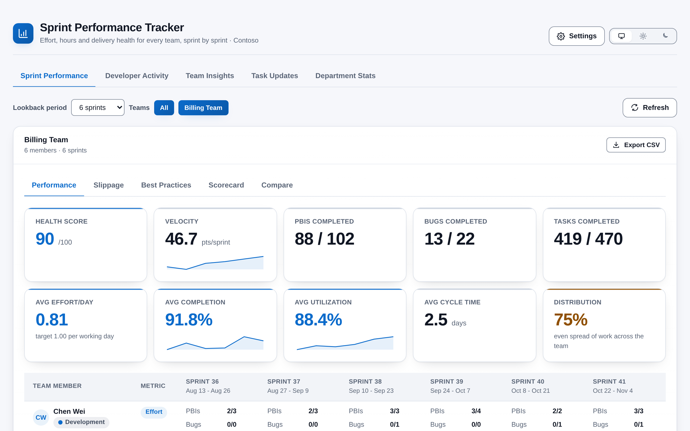
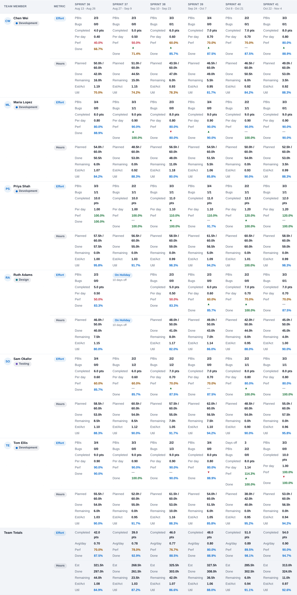
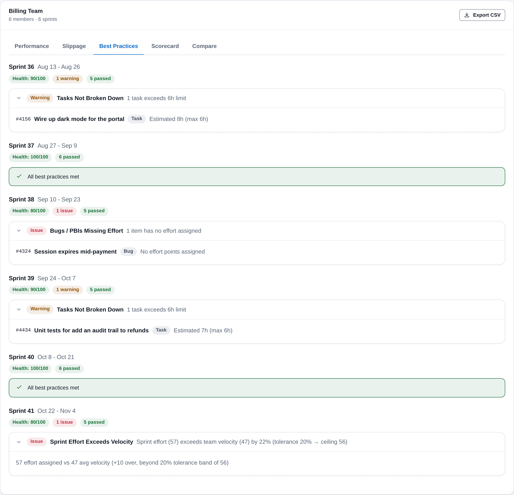
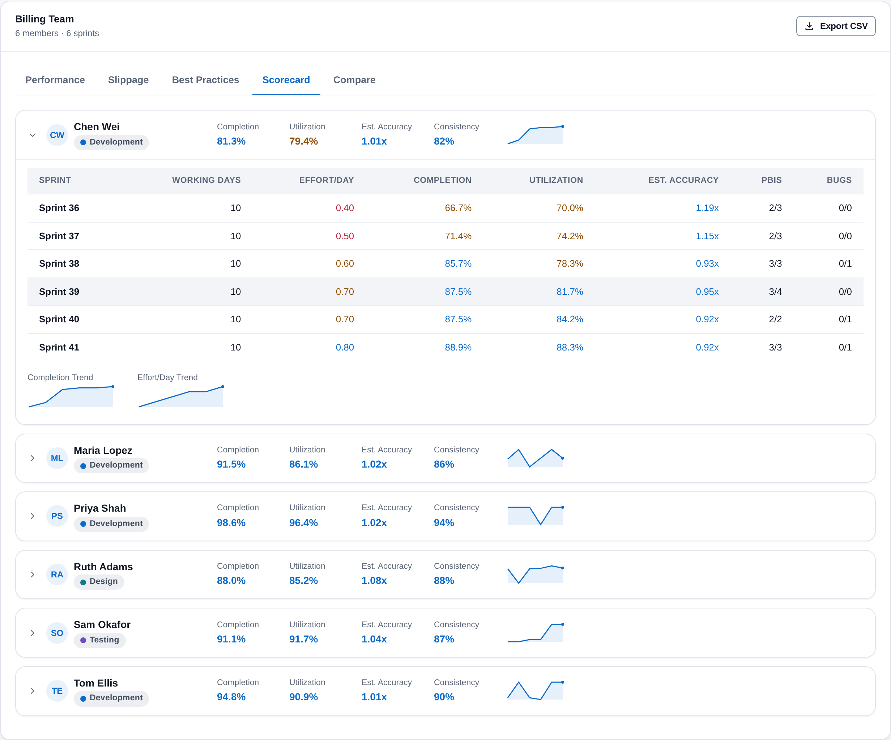
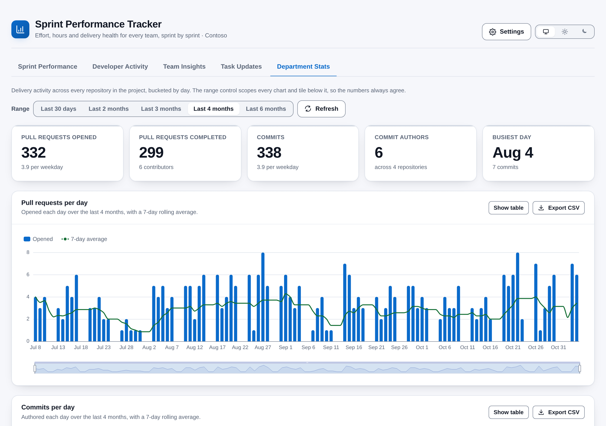

# Sprint Performance Tracker

[](https://github.com/adam-wheater/azure-devops-sprint-performance-tracker/actions/workflows/ci.yml)

Sprint Performance Tracker is an Azure DevOps extension that shows how every team in a project is doing, sprint by sprint. It reads each team's sprints, capacity, days off and work items and turns them into points delivered per working day, task hours against capacity, slippage per work item, a six-rule sprint health check and a scorecard for each person. It is for Scrum masters, delivery leads and engineering managers who want one answer before a retrospective or a planning session: *are we delivering what we plan, and where is the plan breaking down?* Administrators get four more views: developer activity, team insights, task update checks and pull request and commit trends across the department. It lives in the **Boards** menu as **Sprint Performance** and runs entirely in your browser.



## Table of contents

- [Getting started](#getting-started)
- [Features](#features)
- [Screens](#screens)
  - [Access screens](#access-screens)
  - [Header and tabs](#header-and-tabs)
  - [Controls and combined summary](#controls-and-combined-summary)
  - [Team card and summary tiles](#team-card-and-summary-tiles)
  - [Performance table](#performance-table)
  - [Slippage](#slippage)
  - [Best Practices](#best-practices)
  - [Scorecard](#scorecard)
  - [Compare](#compare)
  - [Developer Activity](#developer-activity)
  - [Team Insights](#team-insights)
  - [Task Updates](#task-updates)
  - [Department Stats](#department-stats)
  - [Settings dialog](#settings-dialog)
- [How it works](#how-it-works)
- [Settings](#settings)
- [Calculations](#calculations)
- [Scopes & permissions](#scopes--permissions)
- [Privacy](#privacy)
- [Troubleshooting and known limitations](#troubleshooting-and-known-limitations)
- [Development](#development)
- [Project structure](#project-structure)
- [Tech stack](#tech-stack)
- [Contributing](#contributing)
- [License](#license)

## Getting started

1. Install **Sprint Performance Tracker** by publisher `adam-wheater` from the Visual Studio Marketplace (the listing carries the **Preview** flag).
2. Open a project. The hub is contributed to the **Boards** hub group (`ms.vss-work-web.work-hub-group`, order 99) and appears last in the Boards menu as **Sprint Performance**.
3. **First open:** if nobody has used the extension in the organisation yet, you are created as the only administrator. Everyone else is shown **Access denied** until an administrator adds them.
4. Choose a lookback and the teams to show. The extension lists the teams that have a started sprint.
5. Open **Settings > Users** to add the people who should see it, as viewers or administrators, optionally limiting a viewer to certain teams. Open **Thresholds** to adjust the limits, then reload the page.

For useful numbers, each team needs sprint dates, capacity per person per sprint, Effort on PBIs and Bugs and Original Estimate and Completed Work on Tasks.

## Features

- **Effort and hours side by side** -- For every person and sprint: PBI and Bug effort completed per working day against a 1 point/day target, and Task hours planned, done and remaining against capacity.
- **Capacity aware** -- Working days are the sprint's weekdays minus team days off and personal days off. A person who was away all sprint shows **On Holiday** instead of a failing score.
- **Several teams at once** -- Select any teams and a lookback of 1 to 10 sprints (default 3). Two or more loaded teams add a combined summary with averaged trend lines.
- **Slippage per work item** -- Working days elapsed against the effort estimate for every PBI and Bug, banded On Track, At Risk or Over, with ongoing items marked.
- **Six sprint best-practice checks** -- Missing effort, oversized tasks, several tasks in progress, capacity with no hours, effort above velocity and under-planned hours, rolled into a 0-100 health score per sprint.
- **Per-person scorecard** -- Completion, utilization, estimate accuracy and consistency, with a sprint-by-sprint drill-down and trend lines.
- **Sprint comparison** -- Any two sprints side by side with the change in every metric and whether it is an improvement.
- **Developer activity** -- Commits, files added, modified and deleted, and pipeline runs per developer over the lookback period.
- **Team insights** -- A composite score from pace, effort completion and hours utilization that surfaces top and bottom performers across the selected teams.
- **Task update hygiene** -- Who has not touched a task in 24 hours and who has under 6 completed hours in the last 6.
- **Department stats** -- Pull requests and commits per day across every repository, with a 7-day rolling average, zoom, keyboard access, a table view and CSV export for each chart.
- **Configurable thresholds** -- Performance bands, oversized-task limit, velocity tolerance, under-planned limit and slippage limits, stored for everyone.
- **Access list** -- Administrators and viewers, with optional per-viewer team limits. A convenience gate, not a security boundary (see [Privacy](#privacy)).
- **Remembers your choices** -- Selected teams and lookback are saved per user.
- **CSV export per team** -- Member and team-total tables in one file.
- **Theme follows Azure DevOps** -- Light, dark and high contrast come from the host's `themeApplied` event, with a header toggle to pin light or dark; the toggle hides under a high-contrast theme or OS forced colours.
- **WCAG AA contrast** -- Both palettes are audited to 4.5:1 for text and 3:1 for UI; performance bands always show their number and status pills always carry a word, never colour alone.

## Screens

### Access screens

| State | Screen |
|-------|--------|
| Checking | A skeleton card. Screen readers are told the access check is running. |
| Check failed | **Couldn't check access** with the error message, for example an extension data permission failure. |
| Not on the list | **Access denied**: names the account that was tried and asks you to contact an administrator. |

### Header and tabs

The header is the shared `AppShell`: brand mark, title, subtitle (tagline plus project name), the **Settings** button (administrators only) and the theme toggle.

- **Tabs** (administrators only): Sprint Performance, Developer Activity, Team Insights, Task Updates and Department Stats. A viewer sees no tab strip, only the Sprint Performance page.
- **Settings** (administrators only) opens the [settings dialog](#settings-dialog).

### Controls and combined summary

- **Lookback period** is a drop-down from 1 to 10 sprints. It is shared by the Sprint Performance and Developer Activity pages and is saved with your team choice.
- **Teams** is a row of toggle buttons: **All** and one per team, pressed when selected. With more than five teams a filter box narrows the buttons. Pressing **All** when everything is selected clears the selection.
- **Refresh** reloads the performance data; it shows a spinner and is disabled while loading.
- While data loads, the first load shows an indeterminate progress bar and later reloads show a skeleton of the tiles and a table.
- Errors appear in a red banner. A banner hides the team cards until the error is gone (see [limitations](#troubleshooting-and-known-limitations)).
- With no team selected the page reads "No teams selected. Use the team buttons above to select teams."
- With two or more loaded teams an **All Teams (Combined)** card shows the [summary tiles](#team-card-and-summary-tiles) for the whole selection. Totals are summed across teams, rates are averaged, and the three trend lines are averaged by position from the most recent sprint backwards, so teams on different cadences still line up.
- A footer reads "Runs entirely in your browser · no data leaves Azure DevOps".

### Team card and summary tiles

Each selected team gets a card titled with the team name and the hint `N members · M sprints`. **Export CSV** downloads `<team>_performance_<date>.csv`, containing a `MEMBER PERFORMANCE` section (one row per member and sprint, 18 columns) and a `TEAM TOTALS PER SPRINT` section (19 columns), with a byte-order mark so Excel opens it as UTF-8.

Banners at the top of the card:

- **Data incomplete: failed to load <sprints>** when a sprint failed or timed out.
- **Untracked assignees (not in capacity): <names>** when PBIs or Bugs are assigned to people who are not in the sprint's capacity list. Their effort is not counted anywhere.

The card has five views, chosen with the tab strip: Performance, Slippage, Best Practices, Scorecard and Compare.

The **Performance** view opens with ten summary tiles:

| Tile | Value | Tone |
|------|-------|------|
| **Health Score** | Mean of the sprints' [health scores](#best-practices), out of 100. | Performance band |
| **Velocity** | Mean effort completed per sprint, in points, with a trend line. | Neutral |
| **PBIs Completed**, **Bugs Completed**, **Tasks Completed** | `completed / assigned`, summed over the sprints. | Neutral |
| **Avg Effort/Day** | Mean of the sprints' effort completed per working day, against a target of 1.00. | Performance band |
| **Avg Completion** | Mean effort completion %, with a trend line. | Performance band |
| **Avg Utilization** | Mean hours utilization %, with a trend line. | Performance band |
| **Avg Cycle Time** | Mean weekdays from activation to completion, in days. | Neutral |
| **Distribution** | Mean work distribution score, see [Calculations](#calculations). | Performance band |

The combined card labels the same tiles **Avg Health Score**, **Combined Velocity** and **Avg Distribution**. A trend line is drawn only when there are at least two points.

### Performance table



One row pair per person and one column per sprint. The column header shows the sprint name and its dates. The first cell shows an avatar (or initials), the name and the person's primary role (the capacity activity with the most hours per day, with a coloured dot).

**Effort row** (PBIs and Bugs):

| Line | Meaning |
|------|---------|
| **Days off** | Team plus personal days off in the sprint. Shown only when above zero and the person worked at least one day. |
| **PBIs**, **Bugs** | `completed/total` assigned to the person. |
| **Completed** | Effort points on completed items. |
| **Per day** | Completed points per working day. |
| **Perf** | Per-day figure as a percentage of the 1 point/day target, coloured by band, with an up, down or level arrow against the previous sprint (shown only when the previous sprint had working days; a change of more than 5 points counts as up or down). |
| **Done** | Completed effort as a percentage of assigned effort, coloured by band. |

**Hours row** (Tasks):

| Line | Meaning |
|------|---------|
| **Under-planned** pill | Original estimates are below the under-planned threshold of the capacity available so far in the sprint (see [Calculations](#calculations)). |
| **Planned** | Original Estimate hours / available hours. |
| **Done**, **Remaining** | Completed Work and Remaining Work hours. |
| **Est/Act** | Original Estimate divided by Completed Work. |
| **Util** | Completed Work as a percentage of available hours, coloured by band. |

A cell with no data shows `--`. A cell for a person with zero working days shows an **On Holiday** pill and `N days off`. Hovering a cell shows the working days, assigned points, target and capacity behind it. The footer rows, **Team Totals** (Effort and Hours), sum or recompute the same figures for the whole team.

Band colours: at or above the Excellent threshold is green, at or above Good is blue, at or above Warning is amber, below that red. The defaults are 100, 80 and 60 %.

### Slippage

One section per sprint, with the sprint name and dates, a row of status pills (**On Track**, **At Risk**, **Over**, **Not Started** and, when above zero, **No Effort Set**) and a table of every PBI and Bug.

| Column | Content |
|--------|---------|
| **ID**, **Title**, **Type**, **Assigned To**, **State** | The work item. Type reads PBI or Bug. Ongoing items carry an **In Progress** pill. |
| **Effort (days)** | The Effort field, one point treated as one working day. |
| **Elapsed (days)** | Weekdays from the activated date to the completion date, or to today for an item still in progress. |
| **Slippage** | `elapsed / effort`, coloured by band. |
| **Status** | A pill with the status word. |

A sprint with no PBIs or Bugs shows "No PBIs or Bugs in this sprint."

### Best Practices



One section per sprint with a health pill (`Health: N/100`, green at 80 and above, amber at 60 and above, red below), an issue count, a warning count and a passed count. Each violation is a collapsible row, open by default, with an **Issue** or **Warning** pill, the rule name, a summary and the affected items (`#id`, title, type and a detail line). With no violations the sprint shows "All best practices met".

| Rule | Severity | Raised when |
|------|----------|-------------|
| **Bugs / PBIs Missing Effort** | Issue | A PBI or Bug has no Effort or Effort 0. |
| **Tasks Not Broken Down** | Warning | A Task has an Original Estimate above the max task hours (default 6). |
| **Multiple Tasks In Progress** | Warning | A person has more than one Task in an active state: Active, Committed, In Progress or Doing. |
| **Capacity Members With No Hours** | Warning | A person is in capacity at 0 hours a day and leave does not cover the whole sprint. |
| **Sprint Effort Exceeds Velocity** | Issue | Effort assigned in the sprint is above the team's mean completed effort plus the tolerance (default 20 %). Skipped when that mean is 0. |
| **Hours Utilization Below Threshold** | Warning | Planned hours are above 0 and below the under-planned threshold (default 60 %) of the capacity available so far. |

### Scorecard



One collapsible row per person: avatar, name, role and four figures with a completion trend line, each coloured by band.

| Figure | Definition |
|--------|------------|
| **Completion** | Mean effort completion % across the sprints where the person had working days. |
| **Utilization** | Mean hours utilization % across the same sprints. |
| **Est. Accuracy** | Mean of Original Estimate / Completed Work, shown as `1.14x`. Coloured by `100 - |1 - ratio| x 100`, so 1.00x is best. |
| **Consistency** | `100 - 2 x` the standard deviation of completion %, never below 0. 100 when the person was active in one sprint or fewer. |

Expanding a row shows a table with working days, effort per day, completion, utilization, estimate accuracy, PBIs and Bugs for every sprint (a sprint with no working days is dimmed), and two larger trend lines for completion and effort per day. Only one row is open at a time.

### Compare

Two drop-downs, **Sprint A** and **Sprint B**, default to the last two sprints. The table lists each metric for both and a **Change** column with an arrow for the direction of the change and an *Improved*, *Regressed* or *Unchanged* tooltip. Metrics: Effort Assigned, Effort Completed, Completion %, Avg Effort/Day, Hours Utilization, Est. Accuracy, Cycle Time (days), Distribution Score, PBIs, Bugs and Tasks Completed, and, when both sprints have best-practice data, Health Score, BP Errors and BP Warnings. Higher is better for all except Est. Accuracy, Cycle Time and the two BP counts. With fewer than two sprints the view reads "Need at least 2 sprints to compare." If the lookback shrinks underneath a selection, the selection is clamped.

### Developer Activity

Administrators only. Totals per developer for the last `lookback x 14` days, with the date range in the card hint.

| Column | Content |
|--------|---------|
| **Developer** | Avatar or initials, name and email, from the commit author. |
| **Commits** | Commits authored in any repository in the range. |
| **Files changed** | `+added`, `~modified`, `-deleted` counts from the commit change summaries. |
| **Pipelines** | Pipeline runs requested by the developer in the range. |

Click a header to sort; the first click sorts commits, files and pipelines descending and names ascending, and a second click reverses it. Until you click, rows keep the order the service returned (by name). A developer appears if they have at least one commit or pipeline run. With none, the page reads "No commit or pipeline activity found for the selected range."

### Team Insights

Administrators only. One ranking across all selected teams, drawn from the loaded performance data. When more than one team is selected, a row of team buttons narrows the same ranking; **All** shows the top 10 and bottom 10, any single team shows the top 3 and bottom 3.

Each card shows the rank, avatar, name, an **MVP** pill on the top list, the role, one pill per team the person appears in, and four figures: **Score**, **Pace**, **Effort** and **Hours**. A collapsible *How are these scores calculated?* explains the method, which is [below](#calculations). The bottom list never repeats someone from the top list. Each list has a hint under its title, and the lower list's hint says it is a prompt for a check-in, not a verdict.

### Task Updates

Administrators only. Takes the people in capacity on the selected teams and the iterations of their loaded sprints, then reads the Tasks in those iterations that changed since the date 24 hours ago. Two tiles count the people with **no task update in 24h** and **under 6h completed**, followed by two tables with the person, role, teams, last task update and either the update count (24h) or completed hours (6h). When everyone passes, the table says so. **Refresh** re-reads the data.

The hours figure is a proxy: the current Completed Work on every Task assigned to the person that changed in the last 6 hours.

### Department Stats



Administrators only. A **Range** control sets the window: 30 days, 2, 3, 4 or 6 months (30, 60, 90, 120 or 180 days; default 4 months). Five tiles summarise it:

| Tile | Value |
|------|-------|
| **Pull requests opened** | Pull requests created in the window, with the mean per weekday. |
| **Pull requests completed** | Those with a Completed status, with the number of distinct pull request authors. |
| **Commits** | Commits across all repositories, with the mean per weekday. |
| **Commit authors** | Distinct author emails, with the repository count. |
| **Busiest day** | The day with the most commits, with the count. |

Three chart cards follow: **Pull requests per day** (bars plus a 7-day rolling average), **Commits per day** (the same) and **Pull request throughput** (opened against completed, two rolling-average lines). Each card has **Show table** (the same numbers as an accessible table) and **Export CSV**. The charts show a tooltip on hover, zoom with the wheel, pinch, drag and a range slider, and can be driven from the keyboard (see [Accessibility](#accessibility-checks-applied)). A banner warns when a cap was hit or a repository failed, and says the totals are then a lower bound.

### Settings dialog

Administrators only. Two tabs.

- **Users.** A table of everyone with access: email, name, role, teams and actions. **Promote** and **Demote** switch a role (demoting asks for confirmation); **Remove** asks for confirmation. Your own row has both disabled. A viewer's **Teams** cell shows **All teams** or a count; click it to tick the teams they may see, then **Save**. Below the table, **Add a user** takes an email, display name (defaults to the email), role and, for a viewer, the allowed teams (leave empty for all teams).
- **Thresholds.** Eight numeric fields, each showing its default, with **Save Thresholds** and **Reset to Defaults**. See [Settings](#settings).

## How it works

```
   SDK.init() -> SDK.ready() --> ThemeProvider (data-theme / data-contrast) --> <App/>
        |
        v
   useAccessControl:  SDK.getUser() -> AccessControlService.isUserAuthorized(email)
        |                 (first ever visitor seeds the document as the only admin)
        |   authorized                              thresholds <- document
        v
   IProjectPageService.getProject() -> TeamService.getTeams -> getActiveTeams (started sprint)
        |   viewers: filtered to allowedTeamIds         saved teams + lookback <- user prefs
        v
   per selected team (5 teams at a time)        DataOrchestrator.getTeamPerformance
        |
        v
   WorkRestClient.getTeamIterations -> most recent N started sprints
        |
        v   per sprint (3 at a time, 30 s timeout each)
   getCapacitiesWithIdentityRefAndTotals + getTeamDaysOff + WIQL by iteration path
     -> getWorkItems (200 ids per call, 13 fields)
        |
        v
   PerformanceAggregator: working days, effort, hours, slippage, best practice, totals
        |
        v
   React cards (Metric, Card, Pill, Tabs, Disclosure, SortHeader, SVG sparklines)

   Admin pages fetch on demand:
     Developer Activity  -> Git commits + commit detail + Build runs
     Department Stats    -> project pull requests + commits per repository
     Task Updates        -> WIQL for tasks changed since yesterday, from the loaded sprints
     Team Insights       -> computed from the loaded performance data, no extra calls
```

1. **SDK init.** `src/SprintPerformanceTracker/SprintPerformanceTracker.tsx` runs `SDK.init()` and `SDK.ready()` and renders `<App/>` inside `ThemeProvider`. If the handshake fails, a plain-DOM message ("Sprint Performance Tracker could not connect to Azure DevOps. Refresh the page to try again.") and the error text are shown.
2. **Access check.** `useAccessControl` reads `SDK.getUser()` and looks the lower-cased sign-in name up in the access document. If the document does not exist yet, it is created with the current user as its only administrator. Anyone not on the list sees **Access denied**. Thresholds are read once here.
3. **Project and teams.** `IProjectPageService.getProject()` supplies the project. All teams are listed, then reduced to teams that have at least one started sprint among their five most recent iterations. A viewer limited to certain teams sees only those.
4. **Saved choices.** Selected teams and lookback are restored from the user's own preferences. Saved team ids that are no longer visible are dropped; if none remain, all teams are selected. A lookback outside 1 to 10 is ignored.
5. **Sprints.** For each selected team, `IterationService.getRecentSprints` takes the team's iterations that have start and finish dates and have started, sorts by finish date, keeps the latest N and returns them oldest first.
6. **Per-sprint data.** Capacity (activities per day and personal days off), team days off and the sprint's work items are fetched together. Work items come from WIQL on the exact iteration path for PBIs, Bugs and Tasks that are assigned and not Removed, then fetched in batches of 200. Up to 3 sprints load at once and each has a 30 second timeout; teams load up to 5 at once.
7. **Partial failures.** A sprint that fails or times out is listed on the team card as "Data incomplete" and the rest are shown. If every sprint of a team fails, that team fails.
8. **Calculation.** `PerformanceAggregator` produces per-member and team figures for each sprint, the slippage and best-practice results, and the summary tiles. All of it is described under [Calculations](#calculations).
9. **Persistence.** The access list and thresholds live in one Extension Data Service document; team and lookback choices in another, in the user's own scope. See [Privacy](#privacy).

## Settings

All settings live in extension data. The access list and thresholds share one document for the whole organisation; team and lookback choices are per user.

| Setting | Default | Range in the form | Effect |
|---------|---------|-------------------|--------|
| **Max Task Hours** | 6 | 1-24 | A Task with a larger Original Estimate raises *Tasks Not Broken Down*. |
| **Underplanned Utilization** | 60 % | 0-100 | Under-planned pill and *Hours Utilization Below Threshold* trigger below this. |
| **Velocity Tolerance** | 20 % | 0-100 | Headroom over mean velocity before *Sprint Effort Exceeds Velocity* is raised. |
| **Slippage At-Risk** | 100 % | 50-500 | Slippage above this is At Risk. |
| **Slippage Over** | 200 % | 100-1000 | Slippage above this is Over. |
| **Performance Excellent** | 100 % | 50-200 | At or above this a figure is green. |
| **Performance Good** | 80 % | 30-150 | At or above this it is blue. |
| **Performance Warning** | 60 % | 10-100 | At or above this it is amber; below it is red. |
| Access list | The first person to open the hub, as admin | emails | Who may open the hub, their role and optional team limit. |
| Selected teams, lookback | All visible teams, 3 | lookback 1-10 | Restored on the next visit. Saved per user. |

The ranges are the limits of the number inputs; the code does not clamp a typed value. Saved thresholds are read when the hub opens, so reload the page after saving to apply them (for you and for everyone else). Stored thresholds are merged over the defaults, so a missing field uses its default.

The theme choice is separate: it is kept in browser `localStorage` under `sprint-performance-tracker.theme` (`light` or `dark`; absent means follow Azure DevOps).

## Calculations

All figures are for one sprint and one person unless stated. Only the Scrum type names **Product Backlog Item**, **Bug** and **Task** are read. **Done**, **Closed** and **Resolved** count as completed; **Active**, **Committed**, **In Progress** and **Doing** as in progress; **New**, **Approved**, **To Do** and **Proposed** as not started.

**Working days.** The weekdays from the sprint start date to its finish date, inclusive, minus weekdays that are team days off, minus weekdays that are the person's personal days off (a day that is both is counted once, as a team day off), never below 0.

**Sprint progress.** 0 before the sprint starts, 1 on or after the finish date, otherwise elapsed weekdays divided by total weekdays.

**Capacity per day.** The sum of the person's activity capacities for the sprint. The **primary role** is the activity with the highest capacity, or "Unspecified" when there are none.

**Effort (PBIs and Bugs, assigned to a person in capacity).**

```
assigned        = sum of Effort
completed       = sum of Effort where state is Done, Closed or Resolved
effort per day  = completed / working days            (0 when working days is 0)
performance %   = effort per day / 1.0 x 100
completion %    = completed / assigned x 100          (0 when nothing assigned)
```

**Hours (Tasks, assigned to a person in capacity).**

```
planned (original estimate) = sum of Original Estimate
done                        = sum of Completed Work
remaining                   = sum of Remaining Work
available hours            = working days x capacity per day
utilization %               = done / available hours x 100   (0 when no available hours)
estimate / actual           = planned / done                  (0 when nothing done)
```

**Under-planned.** Applies when available hours and sprint progress are both above 0: `planned / (available x progress) x 100` is below the under-planned threshold. Prorating by progress stops a person being flagged on day two of a sprint.

**Team totals.** Effort and hours are summed over everyone in capacity; `avg effort per day` is total completed effort over total working days; the percentages are recomputed from those totals. The PBI, Bug and Task counts cover every assigned item in the sprint's iteration, including items assigned to people outside capacity.

**Cycle time.** For completed PBIs and Bugs that have an activated date: weekdays from activation to the state change date (or changed date), inclusive, averaged over the sprint.

**Distribution score.** `max(0, round((1 - stddev / mean) x 100))` over the effort assigned to each person, leaving out people whose primary role is "Testing". 100 when there is one person or no effort.

**Summary tiles.** Velocity is the mean over sprints of team effort completed. Counts are summed over sprints. Effort per day, utilization, completion, cycle time and distribution are the means of the sprint values. Health is the mean of the sprint health scores, rounded.

**Slippage (per PBI or Bug).**

- No Effort or Effort 0: **no effort**.
- State New, Approved, To Do or Proposed, or no activated date: **not started**.
- Completed with a completion date (state change date, else changed date): elapsed weekdays from activation to completion.
- Active, Committed, In Progress or Doing: elapsed weekdays from activation to today, marked ongoing.
- Any other state: **not started**.
- `slippage % = elapsed / effort x 100`. Above the Over threshold is **over**, above At-Risk is **at risk**, otherwise **on track**.

**Health score.** `max(0, 100 - 20 x issues - 10 x warnings)`, with a rule counting as passed when it raises nothing.

**Effort exceeds velocity.** `velocity` is the team's mean completed effort over the loaded sprints. The rule fires when assigned effort is above `velocity x (1 + tolerance / 100)`.

**Team Insights score.** Over a person's sprints with working days (merged across teams by sign-in name):

```
pace       = mean performance %      over sprints with effort assigned or completed
completion = mean completion %       over the same sprints
hours      = mean utilization %      over all sprints with working days
score      = min(pace, completion, hours)   each capped to 0-100
             hours alone              when the person had no effort in the window
```

The top list is the highest scores, the bottom list the lowest scores that are not already in the top list. People with no working days in the window are not ranked.

**Task Updates.** `no update in 24h` means zero Tasks assigned to the person changed in the last 24 hours. `under 6h` means the Completed Work on their Tasks changed in the last 6 hours sums to under 6.

**Department Stats.** Pull requests are fetched by creation date (all statuses) and bucketed by creation day; completions are bucketed by closed day and only include pull requests created in the window. Commits are bucketed by author date (committer date if missing) in your local time zone. The rolling average covers 7 days and shortens at the start of the window. The weekday mean divides by Monday to Friday days only.

## Scopes & permissions

| Scope | API calls that need it |
|-------|------------------------|
| `vso.extension.data`, `vso.extension.data_write` | `IExtensionDataManager.getDocument` / `setDocument` for the access list, thresholds and user preferences. |
| `vso.work` | `WorkRestClient.getTeamIterations`, `getCapacitiesWithIdentityRefAndTotals`, `getTeamDaysOff`; `WorkItemTrackingRestClient.queryByWiql` and `getWorkItems`. Read only. |
| `vso.project` | `CoreRestClient.getTeams` (team list). |
| `vso.code` | `GitRestClient.getRepositories`, `getCommits`, `getCommit` (Developer Activity) and `getPullRequestsByProject` (Department Stats). Read only. |
| `vso.build` | `BuildRestClient.getBuilds` (pipeline runs on Developer Activity). Read only. |

The extension never writes to work items, repositories or pipelines.

## Privacy

Everything runs in the browser inside the Azure DevOps extension iframe. Sprint, capacity, work item, commit, pull request and pipeline data is read from your organisation's Azure DevOps REST API and never leaves it. There is no backend, no telemetry and no call to any third-party host, and the extension never modifies work items, repositories or pipelines.

| Data | Where | Scope |
|------|-------|-------|
| Access list (emails, display names, roles, allowed team ids, who added whom and when) and thresholds | Extension Data Service, collection `SprintPerfTrackerSettings`, document `access-control` | Default scope: shared across the organisation |
| Selected team ids and lookback | Extension Data Service, collection `SprintPerfTrackerUserPrefs`, document `user-preferences` | User scope: only you |
| Pinned theme (`light` / `dark`) | Browser `localStorage`, key `sprint-performance-tracker.theme` | This browser only |

Performance data stays in memory and is discarded when you leave the page. The access list is stored where any user of this extension in the organisation can read and write it through the extension data API, which is why it is a convenience gate and not a security boundary.

## Troubleshooting and known limitations

- **Scrum process names only.** Work item types are matched as "Product Backlog Item", "Bug" and "Task", and states as listed under Calculations. Agile **User Story** and CMMI **Requirement** items are not read at all.
- **Only assigned items count.** WIQL asks for items with a non-empty Assigned To, so unassigned items are invisible, including to the missing-effort rule.
- **Exact iteration path.** Items are matched on the sprint's own iteration path. Items in a child path are not included, and an item that moved to a later sprint appears only in that later sprint.
- **People outside capacity.** PBIs and Bugs assigned to someone who is not in the sprint's capacity list are reported in the "Untracked assignees" banner and ignored. Tasks assigned to them are ignored without a banner.
- **Pace reads low mid-sprint.** Effort per working day divides by all of the sprint's working days, not the days so far, so a sprint in progress shows a low pace until it ends. The under-planned check does prorate by progress.
- **Dates are weekdays.** Weekends are skipped but public holidays are only skipped if they are entered as team days off.
- **One point is one day.** The 1 point/day target and the slippage maths treat a point of Effort as a working day; teams that size differently will see consistently low or high figures.
- **Estimate accuracy is 0 with no completed work.** The ratio is Original Estimate divided by Completed Work and is 0, not blank, when nothing is logged.
- **Hours use current values.** Completed Work and Remaining Work are the values on the Task now, for tasks currently in the sprint's iteration.
- **One failed team hides the results.** If any selected team fails to load, an error banner replaces every team card until the cause is fixed or the team is deselected, even though the other teams loaded.
- **Thresholds apply on reload.** Saving thresholds does not refresh the open page. The slippage percentage on the Slippage view is always coloured with the default 100 % and 200 % limits, while its status pills use the saved ones.
- **Two-week sprints are assumed for activity.** Developer Activity covers `lookback x 14` days, which matches two-week sprints but not other lengths.
- **Developer Activity caps.** At most 1,000 commits per repository are read, and file counts come from the first 300 commits found. The page does not say when either cap was hit. Pipeline runs are attributed to the person who requested them.
- **Department Stats caps.** Up to 3,000 pull requests and 3,000 commits per repository are read; the page warns when a cap is reached and when a repository failed, and the totals are then a lower bound. Pull requests created before the window are not fetched, so their completions are not counted.
- **Task Updates are approximate.** The query filters on a date, so it reads from the start of the day 24 hours ago (UTC date), and the hours figure is the current Completed Work on recently changed Tasks, not the hours logged in the window.
- **The access list is not security.** Anyone who can use the extension can read the same data through the REST API and edit the access document. There is no reset: the service refuses to remove or demote the last administrator.
- **Roles are per sign-in name.** Matching uses the lower-cased `SDK.getUser().name` (the UPN in Microsoft Entra organisations). A guest account whose sign-in name differs from the address you typed will not match.
- **Admins cannot demote themselves or remove themselves**, and the service refuses to remove or demote the last administrator.
- **Choices travel differently.** Team and lookback choices follow your account across browsers because they are stored in extension data; the pinned theme does not, because it is stored in `localStorage`.
- **High-contrast detection is a heuristic**, triggered by pure black and white host colours or by OS forced colours.
- **"Could not determine project context."** means the hub was opened outside a project.
- **"Sprint Performance Tracker could not connect to Azure DevOps."** means `SDK.init()` failed; refresh the page.
- **"Extension data access was denied (403)."** means the extension's own authorization is incomplete; check **Organization settings > Extensions** for a pending approval.
- **Re-consent.** If a future version changes the requested scopes, organisation administrators must re-authorise the extension in **Organization settings > Extensions**.

## Development

### Prerequisites

- Node.js 20 or later (`engines.node >= 20`) and npm.
- Install with `npm ci --legacy-peer-deps` (or `npm install --legacy-peer-deps`). The flag is required because of the Azure DevOps SDK and React 18 peer ranges, and CI uses it too.

### npm scripts

| Script | What it does |
|--------|--------------|
| `npm run build` | Production webpack build into `dist/`; `postbuild` runs `scripts/verify-bundle.js`, then `scripts/third-party-notices.js`. |
| `npm run build:dev` | Development build with source maps (CSS still extracted to a file). |
| `npm run screenshots` | Builds the hub on sample data and saves the screenshots to `static/screenshots/` (see below). |
| `npm run verify:bundle` | Re-checks an existing `dist/` without rebuilding. |
| `npm run package` | `tfx extension create` -> `out/*.vsix`. |
| `npm test` | Jest, all projects, verbose. |
| `npm run lint` / `npm run lint:fix` | ESLint 9 flat config over `src/` and `tests/`. |
| `npm run format` / `npm run format:check` | Prettier over `src/**/*.{ts,tsx,css}` and `tests/**/*.{ts,tsx}`. |
| `npm run publish:marketplace` | `tfx extension publish` with `vss-extension.json`. |

### Run it locally with sample data

`demo/` builds the real hub against stand-ins for the Azure DevOps SDK and REST clients, filled with a fictional "Contoso" project: one team, six people and six sprints, plus the repositories and pipelines behind the admin pages. Use it to try the UI without an organisation, and to refresh the screenshots:

```sh
npm i --no-save playwright && npx playwright install chromium   # once
npm run screenshots
```

After that, open `demo/dist/SprintPerformanceTracker/SprintPerformanceTracker.html` in a browser to click around. The sample user is an administrator. `demo/api.ts` holds the sample data and `demo/shots.json` lists the screenshots; the other files in `demo/` are the same in every extension. Nothing in `demo/` ships in the package.

### `build.ps1`

`build.ps1` is the same script in every extension repository (it reads the product name from `vss-extension.json`) and runs the CI steps locally, in CI order:

1. `npm ci --legacy-peer-deps` (the same install as `ci.yml`).
2. `npm run lint` and `npm run format:check`.
3. `npm test`.
4. Bump the version in `vss-extension.json`, `package.json` and both root entries of `package-lock.json` (semver patch +1, e.g. 1.0.9 -> 1.0.10). If any later step fails, all three files are restored.
5. `npm run build` (including `postbuild` bundle verification) and `npm run package`.
6. Check that `out/adam-wheater.<id>-<version>.vsix` exists. If it does not, the script fails instead of reporting an older package.

| Parameter | Effect |
|-----------|--------|
| `-Version 1.1.0` | Release exactly this version instead of the patch bump. |
| `-NoBump` | Package the current version unchanged (cannot be combined with `-Version`). |
| `-SkipInstall` | Reuse the existing `node_modules`. |
| `-SkipTests` | Skip `npm test`. |
| `-SkipChecks` | Skip lint and format check (CI still enforces both). |

The committed version is 1.0.0. `.github/workflows/ci.yml` runs the same install, lint, format check, tests, build, bundle verification and packaging on Node 20, then uploads the `.vsix`.

### Tests

`jest.config.js` defines two projects sharing one `moduleNameMapper` (`@/` alias, CSS -> `styleMock.js`, SDK and API -> `tests/__mocks__`, `echarts/*` -> a recording mock, with controllable REST clients via `__setMockClient` and services via `__setMockService`). No coverage threshold is enforced.

- **unit** -- `testEnvironment: node`, everything under `tests/` except `tests/components/`:
  - `calculations/`: working days, effort, hours, slippage, best-practice rules and the aggregator (totals, cycle time, distribution, health, unmatched assignees).
  - `services/`: iterations, capacity, teams, work items (WIQL escaping and batching), task updates, department stats paging and caps, orchestration (clamped lookback, partial failure, active-team filtering) and the access-control document (seeding, last-admin protection, thresholds merge).
  - `utils/`: date maths, formatting and band tones, cell display state, CSV escaping and rows, concurrency limiting, time-series bucketing and averages, team insights scoring, task update insights, and the theme wiring (storage key matches the page, chart palette matches the CSS tokens).
  - `tests/repo/npmScripts.test.ts`: no npm script single-quotes an argument (cmd.exe does not strip single quotes, so such scripts break on Windows); every script `build.ps1` and CI call is defined; `build.ps1` and `ci.yml` both install with `npm ci --legacy-peer-deps`; and `build.ps1` is ASCII-only with no trailing whitespace after a line-continuation backtick. `tests/repo/packageContents.test.ts` asserts that no `.svg` file sits in any path `vss-extension.json` packages, because the Marketplace rejects them, that manifest icons are existing PNGs and that the extension icon is 128x128.
- **components** -- `testEnvironment: jsdom` with `@testing-library/react`:
  - `App`: access states, the admin tab strip, the viewer view, the settings dialog and the empty and error states.
  - `AccessDenied`, `AdminPanel` (users, confirmation, add, thresholds, focus and Escape handling), `TeamSelector`, `TeamStatsBar` and `CombinedTeamSummary` (tiles, band tones, trend lines), `TeamPerformanceSection` (views, warnings, export), `PerformanceCell`, `SlippageTable`, `BestPracticesView`, `MemberScorecard`, `SprintComparison`, `TeamInsightsPage`, `DeveloperActivityPage` (sorting), `DepartmentStatsPage`, `Sparkline` and `brand`.
  - `TimeSeriesChart` and `chartOptions`: one chart instance, option updates without a rebuild, keyboard stepping, disposal, the empty state, tooltip escaping and the light and dark chart palettes.

### `scripts/verify-bundle.js`

The script reads `HUB` from `webpack.config.js`. It fails the build if any of these is true:

- the entry page is missing;
- the page references an asset that was not emitted;
- no stylesheet was emitted, or an emitted stylesheet is not linked;
- `<HUB>.js` is not loaded;
- `#root` lacks `class="ax-root"`;
- an inline `<style>` sets padding on `#root`;
- a lazy chunk in the webpack runtime map is missing;
- an emitted script contains an AMD `define(`;
- a `.d.ts` file leaked into `dist/`.

### Design system

- `src/styles/app.css` -- the shared stylesheet: `--ax-*` tokens on `:root`, redefined under `:root[data-theme="dark"]` and mapped to host variables under `:root[data-contrast="high"]`, plus the `.ax-*` component classes (shell, header, cards, metrics, pills, tables, forms, progress, banners, footer). This product adds no styles of its own: it composes the shared classes and sets colours with `var(--ax-*)` tokens.
- `src/components/ui.tsx` -- the primitives: `AppShell`, `ThemeToggle`, `Tabs`, `Button`, `Card`, `Pill`, `Metric`, `Banner`, `Progress`, `Skeleton`, `EmptyState`, `Gate`, `Modal`, `ConfirmDialog`, `Disclosure`, `SortHeader`, `ErrorBoundary` and the inline SVG icons.
- `src/components/MemberBits.tsx` and `src/components/Sparkline.tsx` -- this product's avatar, role pill and trend line, built from the same classes.
- `src/brand.tsx` -- `BRAND` (id, name, tagline) and `BrandGlyph`, the Lucide `chart-column-increasing` mark drawn as inline SVG in the bundle. The only packaged icon file is `static/icon.png` (128x128 PNG): the Marketplace rejects `.svg` files in extension packages.

### Theming

The SDK's `init()` writes the host theme as CSS variables on `:root` and dispatches `themeApplied`, on load and on every later change. `ThemeProvider` (`src/utils/theme.ts`) re-reads the variables on that event, on `prefers-color-scheme` and `forced-colors` changes, and on body-class changes. It picks light or dark from the host background's luminance, detects high contrast, and sets `data-theme` and `data-contrast` on `<html>`.

Resolution order is high contrast, then the user's pinned light / dark choice, then the Azure DevOps theme, then the body class, then `prefers-color-scheme`. `useTheme()` returns the palette for the charts: the department charts take their series colours and chrome from it, and the sparklines, performance bands and role dots use `--ax-*` tokens directly. The host page applies the stored choice before the bundle loads, so a dark host never flashes light.

### Accessibility checks applied

- **Contrast:** both palettes meet WCAG 2.1 AA (4.5:1 for text, 3:1 for UI and chart series).
- **Text alongside colour:** every band-coloured figure is printed as a number, status pills and best-practice severities are written out, and the Compare arrows sit beside the change values.
- **Labels:** every form control has a `<label>` or an `aria-label`; tables carry an `aria-label`.
- **Roles and states:** tabs use `role="tablist"` / `role="tab"` with `aria-selected`; team, range and table toggles use `aria-pressed`; collapsible rows use `aria-expanded`; sortable headers expose `aria-sort`; sparklines are `role="img"` with a label; error banners are `role="alert"`; the progress bar is `role="progressbar"`.
- **Dialogs:** `Modal` traps focus, closes on Escape, labels itself by its title and restores focus on close. The confirmation dialog is a sibling of the settings dialog, so each trap stays separate.
- **Charts:** the chart is focusable (`role="application"`), arrow keys step the tooltip a day at a time, Home and End jump to the ends, Escape hides the tooltip, and each chart card offers the same numbers as a table.
- **CSS:** `:focus-visible`, `prefers-reduced-motion` and `forced-colors` are handled.

## Project structure

```
sprint-performance-tracker/
├── src/
│   ├── SprintPerformanceTracker/
│   │   ├── SprintPerformanceTracker.html   # Host page: links the extracted CSS, stamps stored theme, #root.ax-root
│   │   └── SprintPerformanceTracker.tsx    # Entry: SDK.init -> ready -> render <ThemeProvider><App/>
│   ├── brand.tsx                           # BRAND constants and BrandGlyph logo
│   ├── calculations/
│   │   ├── WorkingDaysCalculator.ts        # Weekdays minus team and personal days off
│   │   ├── EffortCalculator.ts             # PBI and Bug effort per member, unmatched assignees
│   │   ├── HoursCalculator.ts              # Task estimate, completed and remaining hours per member
│   │   ├── SlippageCalculator.ts           # Elapsed weekdays against effort, status banding
│   │   ├── BestPracticeCalculator.ts       # Six sprint rules and the health score
│   │   └── PerformanceAggregator.ts        # Per-member rows, team totals, summary stats
│   ├── components/
│   │   ├── App.tsx                         # Gates, shell, tab strip, controls, team cards, admin dialog, footer
│   │   ├── ui.tsx                          # Shared primitives and icons
│   │   ├── AccessDenied.tsx                # Access denied gate
│   │   ├── AdminPanel.tsx                  # Settings dialog: users, team limits, thresholds
│   │   ├── SprintLookbackControl.tsx       # 1-10 sprint drop-down
│   │   ├── TeamSelector.tsx                # Team toggle buttons and filter
│   │   ├── LoadingSkeleton.tsx             # Tiles and table placeholder
│   │   ├── CombinedTeamSummary.tsx         # Summary card across teams
│   │   ├── TeamPerformanceSection.tsx      # Team card: banners, CSV export, five views
│   │   ├── TeamStatsBar.tsx                # Ten summary tiles
│   │   ├── PerformanceTable.tsx            # Member x sprint table with totals
│   │   ├── PerformanceTableRow.tsx         # Member name cell and a row of cells
│   │   ├── PerformanceCell.tsx             # Effort and hours cells, team totals cells
│   │   ├── TeamTotalsRow.tsx               # Team totals rows
│   │   ├── SlippageView.tsx                # Slippage sections per sprint
│   │   ├── SlippageTable.tsx               # Status pills and work item table
│   │   ├── BestPracticesView.tsx           # Health pills and collapsible violations
│   │   ├── MemberScorecard.tsx             # Per-person scorecard rows
│   │   ├── SprintComparison.tsx            # Two-sprint comparison
│   │   ├── DeveloperActivityPage.tsx       # Commits, files, pipelines per developer
│   │   ├── TeamInsightsPage.tsx            # Top and bottom performers
│   │   ├── TaskUpdatePage.tsx              # Stale and low-hours task updates
│   │   ├── DepartmentStatsPage.tsx         # Pull request and commit charts
│   │   ├── MemberBits.tsx                  # Avatar, RolePill, MemberName
│   │   ├── Sparkline.tsx                   # Hand-rolled SVG trend line
│   │   └── charts/
│   │       ├── TimeSeriesChart.tsx         # ECharts wrapper: zoom, tooltip, keyboard, theme
│   │       └── chartOptions.ts             # Pure option builder, tooltip HTML, ChartTheme
│   ├── hooks/
│   │   ├── useAccessControl.ts             # Sign-in check, role, allowed teams, thresholds
│   │   ├── usePerformanceData.ts           # Per-team loading with stale-request guard
│   │   └── useDeveloperActivity.ts         # Range activity hook (not mounted by the current pages)
│   ├── models/
│   │   ├── enums.ts                        # WorkItemType, UserRole, state lists
│   │   └── interfaces.ts                   # Data models, DEFAULT_THRESHOLDS
│   ├── services/
│   │   ├── TeamService.ts                  # Project teams
│   │   ├── IterationService.ts             # Recent started sprints per team
│   │   ├── CapacityService.ts              # Member capacity and days off
│   │   ├── WorkItemService.ts              # WIQL by iteration path, batched getWorkItems
│   │   ├── DataOrchestrator.ts             # Active teams, per-team load with timeout and partial failure
│   │   ├── AccessControlService.ts         # Access document, roles, team limits, thresholds
│   │   ├── UserPreferencesService.ts       # Selected teams and lookback (user scope)
│   │   ├── DeveloperActivityService.ts     # Commits, commit detail, builds
│   │   ├── TaskUpdateService.ts            # Tasks changed since a date
│   │   └── DepartmentStatsService.ts       # Pull request pager and per-repository commits
│   ├── styles/
│   │   └── app.css                         # Design system tokens and .ax-* classes
│   └── utils/
│       ├── constants.ts                    # Fields, limits, thresholds, token colours
│       ├── dateUtils.ts                    # Weekday counting, working days, sprint progress
│       ├── formatting.ts                   # Number, date and band helpers
│       ├── cellHelpers.ts                  # Holiday and days-off display state
│       ├── csvExport.ts                    # CSV escaping, rows and team export
│       ├── concurrency.ts                  # promiseAllSettledWithLimit
│       ├── teamAggregation.ts              # Combined summary across teams
│       ├── teamInsights.ts                 # Composite score, MVP and support lists
│       ├── taskUpdateInsights.ts           # Stale and low-hours calculation
│       ├── timeSeries.ts                   # Day bucketing, moving average, summaries
│       └── theme.ts                        # Host theme detection, ThemeProvider, useTheme, useThemeMode
├── tests/
│   ├── __mocks__/
│   │   ├── azure-devops-extension-api.ts   # getClient mock, REST client stubs
│   │   ├── azure-devops-extension-sdk.ts   # SDK mock (init, ready, getUser, getService, ...)
│   │   ├── echarts.ts                      # Recording ECharts mock
│   │   └── styleMock.js                    # Empty module for CSS imports
│   ├── calculations/                       # One suite per calculator and the aggregator
│   ├── components/                         # Component suites (jsdom)
│   ├── repo/
│   │   ├── npmScripts.test.ts              # Windows-safe npm scripts, ASCII build.ps1, CI/script install parity
│   │   └── packageContents.test.ts         # No .svg file in any path the manifest packages
│   ├── services/                           # Service suites against mocked REST clients
│   └── utils/                              # Pure helper suites and theme wiring
├── demo/                                   # Runs the hub on sample data, for screenshots (never shipped)
│   ├── api.ts                              # Sample "Contoso" project behind stand-in REST clients
│   ├── shots.json                          # Which screenshots to take, and the clicks before each
│   └── kit.ts, sdk.ts, shots.js, webpack.config.js   # Same in every extension
├── scripts/
│   ├── third-party-notices.js              # Post-build: dist/THIRD-PARTY-NOTICES.txt from runtime dependencies
│   └── verify-bundle.js                    # Post-build dist/ sanity check
├── static/
│   ├── icon.png                            # Marketplace and hub icon (128x128 PNG; the only icon file, no .svg is packaged)
│   └── screenshots/                        # README and Marketplace screenshots (PNG, from npm run screenshots)
├── .github/workflows/ci.yml                # Install, lint, format, test, build, verify, package
├── LICENSE                                 # Proprietary source-available license
├── SECURITY.md                             # How to report a vulnerability privately
├── overview.md                             # Marketplace listing page
├── vss-extension.json                      # Extension manifest (hub, scopes, files)
├── webpack.config.js                       # Entry, CSS extraction, HTML copy, chunk layout
├── tsconfig.json                           # Strict TypeScript, @/ alias, no declarations
├── jest.config.js                          # unit (node) + components (jsdom) projects
├── eslint.config.js                        # ESLint 9 flat config + Prettier
├── .prettierrc.json                        # Prettier rules
├── .vsixignore                             # Files excluded from the .vsix
├── build.ps1                               # Shared build: npm ci, lint, format, test, bump 3 manifests, build, package
└── package.json                            # Scripts and dependencies
```

## Tech stack

| Category | Technology |
|----------|-----------|
| Framework | React 18 (`createRoot`) |
| Language | TypeScript 5, strict mode, ES2020 target |
| Bundler | Webpack 5 with ts-loader, mini-css-extract-plugin, css-minimizer, copy-webpack-plugin |
| Testing | Jest 29, ts-jest, jest-environment-jsdom, @testing-library/react, @testing-library/jest-dom |
| Linting | ESLint 9 flat config, typescript-eslint, Prettier 3 |
| SDK / API | azure-devops-extension-sdk 4.x, azure-devops-extension-api 4.x (Core, Work, Work Item Tracking, Git and Build clients, common host services) |
| Charts | Hand-written SVG sparklines; Apache ECharts 6 for the department charts, with only the bar and line charts, grid, tooltip, legend, zoom and aria components and the SVG renderer registered |
| Packaging / CI | tfx-cli, GitHub Actions |

## Contributing

> This project is source-available, not open source. Bug reports and feature requests are
> welcome through GitHub Issues. Code contributions are accepted only by prior written
> agreement; anything you submit is licensed to the project owner under section 4 of the
> LICENSE.

## License

> Copyright © 2026 Adam Wheater. All rights reserved.
>
> This software is provided under a proprietary source-available license: you may read and
> audit the code and use the published extension, but you may not copy, modify, redistribute
> or republish it. See [LICENSE](LICENSE) for the full terms.
>
> Open source components bundled into the extension keep their own licenses. `npm run build`
> writes their notices to `dist/THIRD-PARTY-NOTICES.txt`, which ships inside the package.
