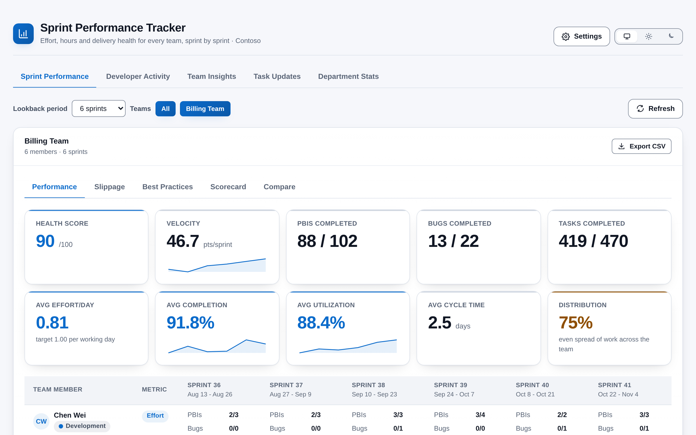
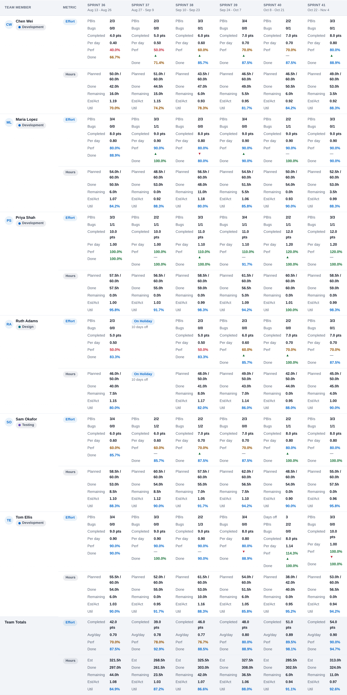

# Sprint Performance Tracker

**How is each team really doing, sprint by sprint?** Sprint Performance Tracker reads your teams' iterations, capacity and work items and shows effort delivered, hours used, slippage and sprint hygiene for every team in a project, in one place. It lives under **Boards > Sprint Performance** and runs entirely in your browser.

## What you see

| View | Answers |
|------|---------|
| **Sprint Performance** | Per person and per sprint: effort points completed per working day against a 1 point/day target, completion of what was assigned, and task hours planned, done and remaining against capacity. A summary strip sits above the table and team totals at its foot. |
| **Slippage** | For each PBI and Bug: working days elapsed against the effort estimate, banded On Track, At Risk or Over. |
| **Best Practices** | Six sprint checks (missing effort, oversized tasks, several tasks in progress, capacity with no hours, effort above velocity, under-planned hours) and a 0-100 health score per sprint. |
| **Scorecard** | Per person: completion, utilization, estimate accuracy and consistency across the lookback, with a drill-down per sprint. |
| **Compare** | Any two sprints side by side with the change in every metric. |
| **Developer Activity** (admins) | Commits, files changed and pipeline runs per developer over the lookback period. |
| **Team Insights** (admins) | Top and bottom performers across the selected teams, scored from pace, completion and hours, as a prompt for a conversation rather than a verdict. |
| **Task Updates** (admins) | Who has not updated a task in the last 24 hours, and who has under 6 completed hours in the last 6. |
| **Department Stats** (admins) | Pull requests and commits per day across every repository, with a rolling average, zoomable charts, table views and CSV export. |

## What you get

- **Capacity aware** -- Working days come from each sprint's dates minus team days off and personal days off, so a holiday never counts as a bad week.
- **Several teams at once** -- Pick any teams and 1 to 10 sprints of lookback. With two or more teams you also get a combined summary.
- **Configurable thresholds** -- Admins set the performance bands, the oversized-task limit, the velocity tolerance, the under-planned limit and the slippage limits. Defaults are 100 / 80 / 60 %, 6 hours, 20 %, 60 % and 100 / 200 %.
- **Who can see it** -- The first person to open the hub becomes an administrator. Admins add people as viewers and can limit a viewer to chosen teams. This is a convenience gate, not a security boundary.
- **CSV export** -- One click per team for the member and team-total tables.
- **Looks like Azure DevOps** -- Follows your light, dark or high-contrast theme, with a toggle to pin light or dark. Every score and status carries a label, never colour alone, and both palettes meet WCAG AA contrast.

## How it works

1. Open **Boards > Sprint Performance**. The extension lists the project's teams that have a started sprint.
2. It loads each selected team's recent sprints, member capacity, days off and work items straight from your organisation's Azure DevOps REST API.
3. Everything is calculated in your browser and shown as tables, tiles and charts. Your team and lookback choices are remembered for you.
4. Admins open **Settings** to manage access and thresholds.

## Permissions, in plain words

- **Work items and iterations (read)** -- To read sprints, capacity, days off and the work items in them. The extension never edits a work item.
- **Code and builds (read)** -- For the Developer Activity and Department Stats views: commits, pull requests and pipeline runs.
- **Project** -- To list the project's teams. Who you are comes from your Azure DevOps sign-in.
- **Extension data (read and write)** -- To store the access list, the thresholds and your own team and lookback choices.

## Privacy

All analysis happens in the browser inside the Azure DevOps page. Work item, commit and pull request data never leaves your Azure DevOps organisation, nothing is sent to any other service, and there is no telemetry. The only things stored are the access list and thresholds (in the Azure DevOps Extension Data Service, shared across your organisation), your team and lookback choices (in the same service, for you only) and your theme preference (in your own browser).

## Requirements

- Azure DevOps Services, or Azure DevOps Server 2020 or later.
- Teams that use iterations with start and finish dates, and capacity set per sprint.
- The Scrum process work item types: Product Backlog Item, Bug and Task, with Effort on PBIs and Bugs and Original Estimate and Completed Work on Tasks.
- Read access to work items. Developer Activity and Department Stats also need read access to the project's repositories and pipelines.

## Support

Report problems or request features through GitHub Issues: https://github.com/adam-wheater/azure-devops-sprint-performance-tracker/issues

## License

Copyright © 2026 Adam Wheater. All rights reserved. This software is provided under a proprietary source-available license: you may read and audit the code and use the published extension, but you may not copy, modify, redistribute or republish it. See the LICENSE file for the full terms. The open source components it bundles keep their own licenses, listed in THIRD-PARTY-NOTICES.txt inside the package.
